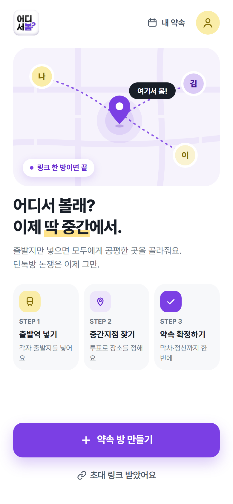
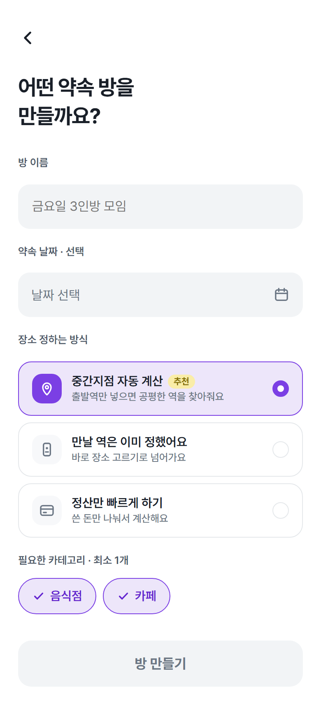
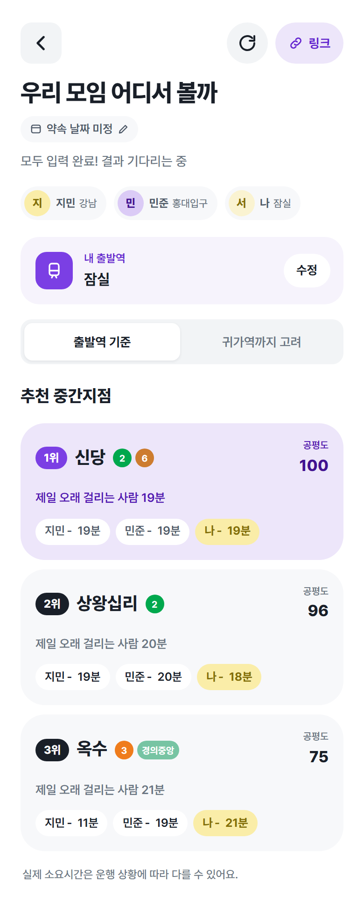
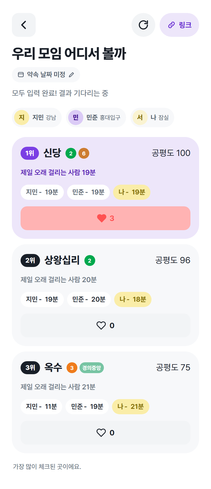
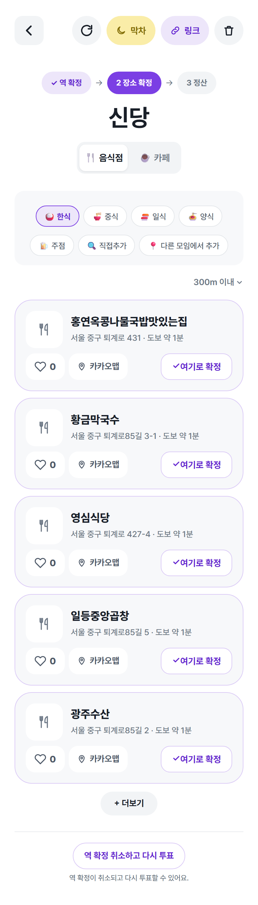
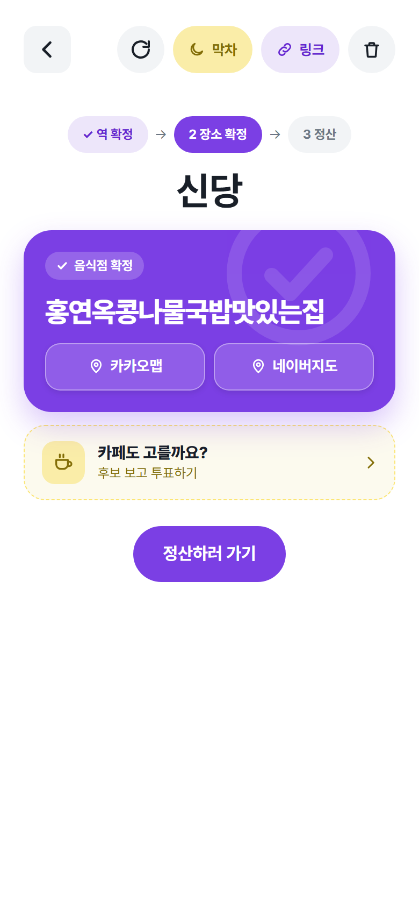
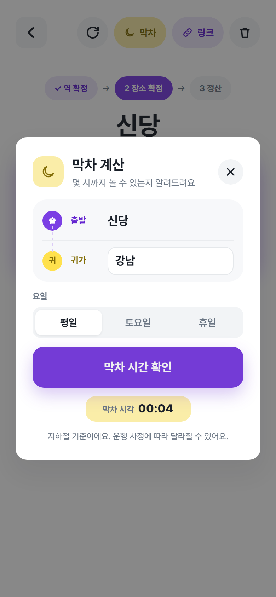
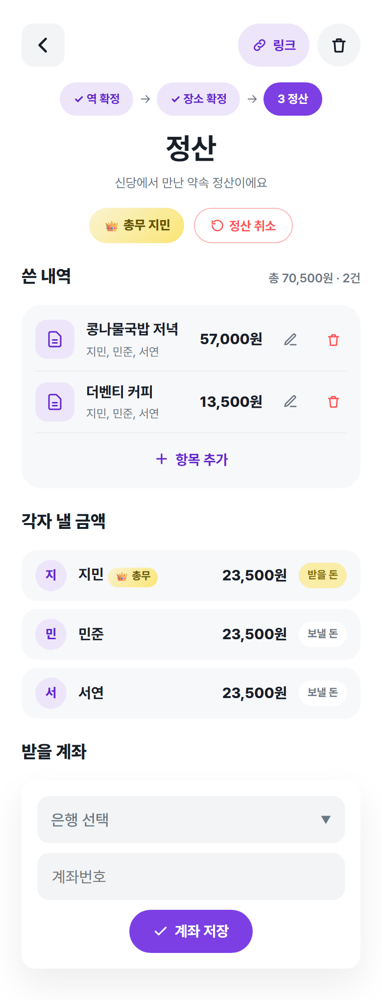
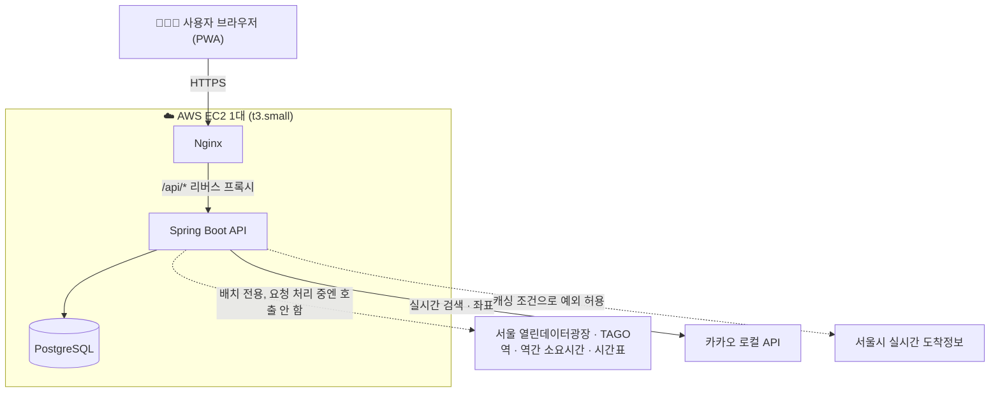

<div align="center">


# 🚇 어디서봄

**친구 모임의 날짜, 공평한 중간지점, 막차, 정산을 링크 하나로.**
설치도 가입도 없이, 링크만 열면 바로 참여하는 모임 준비 웹앱(PWA)입니다.

[](#)
[](#)
[](#)
[](#)
[](#)
[](#)
[](#)

### [🔗 지금 바로 써보기 →](https://xn--2z1bo4m2odm3f.kr)

</div>

<br/>

> 📌 — 2026년 10월부터 기획·설계·백엔드·프론트엔드·인프라·운영까지 **1인으로 진행 중인 개인 프로젝트**입니다. 핵심은 "외부 길찾기 API를 실시간으로 호출하지 않고, 공공데이터를 직접 적재해 서버 안에서 계산한다"는 점이에요. 아래에서 왜 이렇게 만들었는지, 어떤 문제를 어떻게 풀었는지 차례로 설명합니다.

<br/>

## 목차

- [왜 만들었나](#why)
- [핵심 플로우](#flow)
- [기술적으로 신경 쓴 부분](#deep-dive)
- [기술 스택](#stack)
- [설계 원칙](#principles)
- [프로젝트 구조](#structure)
- [로컬 실행](#run)

<br/>

<a id="why"></a>
## 💭 왜 만들었나

친구들과 약속을 잡을 때마다 똑같은 과정을 반복합니다. 단톡방에서 "어디서 볼까"로 시작해 누군가의 집·회사 근처로 은근슬쩍 정해지고, 막차 시간은 각자 네이버에 검색하고, 정산은 누가 얼마를 더 냈는지 계산기를 두드립니다.

**어디서봄**은 이 과정 전체를 하나의 링크로 묶었습니다. 참여자가 각자 출발역만 입력하면 전원에게 가장 공평한 역을 자동으로 계산해 제시하고, 투표로 확정하고, 막차 시간을 알려주고, 끝나면 정산까지 끝냅니다. 로그인도 앱 설치도 없이, 링크를 받은 사람은 닉네임만 입력하면 바로 참여합니다.

<br/>

<a id="flow"></a>
## 🧭 핵심 플로우

### 0️⃣ 링크 하나로 시작

방장이 날짜·시간 모드를 골라 방을 만들면 바로 공유 링크가 생성됩니다. 참여자는 앱을 설치하거나 회원가입을 할 필요 없이, 링크를 열고 닉네임만 입력하면 그대로 모임에 합류합니다.




### 1️⃣ 출발역만 넣으면 — 공평한 중간지점 자동 계산

참여자가 출발역을 입력할 때마다 서버가 **사전에 계산해둔 지하철 소요시간 그래프**로 전원이 도달 가능한 역 전체를 훑어, "제일 오래 걸리는 사람"을 최소화하는 순서로 상위 3개 후보를 제시합니다. 후보마다 참여자별 소요시간과 0~100점의 공평도 점수를 함께 보여줘서, "왜 이 역인지"가 바로 납득되게 했습니다.



### 2️⃣ 다중 투표로 확정

추천 후보에 전원이 "괜찮아요"를 체크하는 방식입니다. 득표 1위가 동점이면 공평도로, 그래도 같으면 방장이 직접 고릅니다. 2명뿐인 방은 둘 다 체크한 곳이 바로 합의점이 됩니다.



### 3️⃣ 역이 정해지면 — 맛집·카페도 투표로

역이 확정되면 카카오 로컬 API로 반경 내 음식점·카페를 실시간 검색해 보여줍니다. 추천 후보 외에 참여자가 직접 키워드로 검색해 후보를 추가할 수도 있고, 이렇게 추가된 가게는 **역 단위로 누적 저장**돼 같은 역에서 모이는 다른 모임에도 "다른 모임이 추가한 곳"으로 제안됩니다. 모임이 쌓일수록 추천 풀도 함께 자라는 구조입니다.




### 4️⃣ 약속 당일 — 막차 계산

귀가역을 입력하면 서버가 **배치로 미리 적재해둔 열차 시간표**를 거꾸로 역산해 각자의 막차 출발 시각을 계산합니다. 외부 경로 API를 요청 시점에 호출하지 않고 전부 서버 내부 계산으로 끝내 응답이 빠르고 비용이 들지 않습니다. 귀가역은 본인에게만 보이고, 다른 참여자에게는 막차 시각만 공개됩니다.



### 5️⃣ 모임이 끝나면 — 정산

먼저 "정산 시작"을 누른 사람이 결제자가 되고, 항목을 추가하면 참여자별 분담액이 자동으로 계산됩니다. 영수증 사진을 올리면 Gemini API가 상호명·금액을 읽어 항목을 자동으로 채워주고, 송금은 토스·카카오페이 앱 링크로 바로 연결합니다(서비스가 돈을 직접 받지 않습니다).



<br/>

<a id="deep-dive"></a>
## 🛠️ 기술적으로 신경 쓴 부분

### 🗺️ 경로 API를 쓰지 않고 지하철 소요시간을 직접 계산

중간지점·막차 계산은 사용자 요청을 처리하는 동안 **외부 API를 한 번도 호출하지 않습니다.** 서울 열린데이터광장·TAGO·GTFS의 역 목록, 역간 소요시간, 열차 시간표를 배치로 DB에 적재해두고, 모든 역 쌍에 대해 다익스트라로 최단 경로를 미리 계산해 저장합니다.

말은 간단하지만, 공공데이터 자체가 깨끗하지 않다는 게 진짜 문제였습니다.

- 역명이 시대·노선마다 다르게 표기되는 문제, 노선별 역 순서 정리부터 다시 해야 했습니다.
- **9호선**은 역간 소요시간 실측 데이터 대상에서 통째로 빠져 있어서, GTFS 원본의 같은 운행(trip) 안 연속 정차역 사이 실제 경과시간을 직접 뽑아 median으로 보강했습니다.
- **성수역**처럼 2호선 본선과 지선이 겹치는 역은 시간표 API가 한 페이지(500건) 분량만 돌려주고 끝나버려서, 저녁 이후 시간표가 통째로 누락되는 걸 나중에야 발견했습니다. 페이지네이션을 추가해 해결했습니다.
- 급행 운행이 있는 노선은 역을 건너뛰기 때문에 역간 소요시간 계산에서도 같이 제외되는데, 이건 아직 완행 기준으로만 계산되는 **알려진 한계**로 남겨뒀습니다.

### 🚆 막차는 "가장 늦게 출발해도 되는 경로"를 역산

막차 계산은 단순히 최단 경로 하나를 보는 게 아니라, 약속역과 귀가역을 잇는 **경로 후보 전부**를 시간표 기준으로 거꾸로 역산해서 가장 늦은 출발 시각을 채택합니다.

처음엔 "가장 빠른 경로부터 시도해서 값이 나오면 멈춘다" 방식으로 구현했는데, 왕십리→노원 같은 구간의 토요일 조회가 저녁 19시대로 뚝 끊기는 버그가 있었습니다. 원인을 추적해보니 TAGO 데이터엔 실제 열차 번호가 없어서 역마다 시간 순서로 번호를 합성해 붙이고 있었는데, 중간에서 시종착하는 열차가 섞이면 이 합성 순번이 역마다 어긋나면서 가장 빠른 경로의 결과가 실제보다 훨씬 이르게 나온 게 원인이었습니다. "노선을 물리적 순서대로 따라가며 직전 역 기준으로 이어붙이는" 체이닝 방식으로 바꾸고, 역산 로직도 "모든 경로 조합을 비교해서 가장 늦은 출발 시각을 채택"하도록 수정해서 해결했습니다.

### 🔐 로그인 없이, 그러나 안전하게

가입 절차 없이 기기마다 익명 UUID를 발급하고, 인증 토큰은 원문을 서버에 저장하지 않고 **SHA-256 해시만** 저장합니다(조회 가능해야 해서 매번 salt가 바뀌는 bcrypt 대신 결정론적 해시를 선택). "방장만", "결제자만" 같은 권한은 인증과 분리해 서비스 레이어에서 검사합니다. 추후 소셜 로그인을 붙일 수 있도록 `oauth_provider`/`oauth_id` 컬럼만 nullable로 미리 마련해뒀습니다.

### 💸 1대의 서버로 운영 비용 최소화

RDS·ALB·NAT Gateway 같은 관리형 서비스 없이, EC2 한 대에 Nginx·Spring Boot·PostgreSQL을 Docker Compose로 함께 올렸습니다. CI에서 이미지를 빌드해 Docker Hub에 올리고 서버는 pull만 하는 구조라, 배포 시 서버 리소스를 거의 쓰지 않습니다.



<br/>

<a id="stack"></a>
## 🧰 기술 스택

| 영역 | 스택 |
|---|---|
| 🔧 Backend | Java 17 · Spring Boot 4 · Spring Data JPA · Spring Security · PostgreSQL · Flyway · Gradle |
| 🎨 Frontend | React 19 · Vite · JavaScript · PWA(vite-plugin-pwa) · Axios |
| ☁️ Infra | Docker Compose(Nginx + API + PostgreSQL) on AWS EC2 · Terraform · GitHub Actions |
| 🔌 외부 연동 | 카카오맵/카카오 로컬 API · 서울시 공공데이터 · TAGO 국가대중교통정보 · Gemini API(영수증 인식) |

<br/>

<a id="principles"></a>
## 📐 설계 원칙

개인 프로젝트로 혼자 기획·설계·개발·배포까지 맡으면서 아래 원칙을 지키려 했습니다.

- 💰 **비용 최소화**: 관리형 유료 서비스를 쓰지 않고 EC2 한 대로 운영
- 🚪 **로그인 없음**: 링크 하나로 설치·가입 없이 바로 참여하는 경험이 핵심 가치
- 🙅 **돈을 직접 받지 않음**: 정산은 계산만 제공, 송금은 토스·카카오페이 앱으로 넘김
- 📦 **외부 API는 배치로, 요청 중엔 호출 안 함**: 응답 속도와 비용 모두를 위해 공공데이터는 미리 계산해둠
- 🚇 **지하철만 지원**: 버스·자차까지 포함한 경로 계산은 정확도·비용 문제로 범위를 좁힘

<br/>

<a id="structure"></a>
## 📁 프로젝트 구조

```
backend/
└── src/main/java/com/hong/halfway/
    ├── global/         SecurityConfig, 에러 처리, 공통 유틸
    └── domain/
        ├── user         익명 사용자, 토큰 발급
        ├── room         방 생성·조회·모드·상태
        ├── participant  방 참여, 출발역·귀가역
        ├── midpoint     중간지점 계산 (다익스트라 기반)
        ├── vote         역 후보·투표
        ├── place        음식점·카페 후보·투표 (카카오 로컬 API 연동)
        ├── lasttrain    막차 역산 계산
        ├── settlement   정산 항목·분담·영수증 인식(Gemini)
        └── station      역·이동시간 데이터 + 배치 적재(batch)

frontend/
└── src/
    ├── api/             axios 공통 인스턴스 + 도메인별 API 함수
    ├── pages/           HomePage, JoinPage, PrivacyPolicyPage 등 라우트 단위 페이지
    ├── features/        도메인별 로직 묶음 — midpoint, vote, places, lasttrain, settlement, room
    │                     (각 도메인의 훅 + 전용 컴포넌트를 한 폴더에)
    ├── stores/          기기별 익명 사용자 Context/Provider
    ├── components/      여러 페이지에서 쓰는 공통 UI, 레이아웃
    ├── hooks/ · utils/  공통 훅, 순수 함수
    └── styles/          디자인 토큰 (색상 하드코딩 금지)

infra/                   Terraform (EC2 · 보안그룹 · Elastic IP)
```

<br/>

<a id="run"></a>
## 🖥️ 로컬 실행

```bash
# DB
docker compose up -d

# 백엔드
cd backend && ./gradlew bootRun

# 프론트엔드
cd frontend && npm install && npm run dev
```

카카오 로컬 API, Gemini API 등 외부 연동 키는 `backend/.env.example`, `frontend/.env.example`을 참고해 `.env`로 채워야 합니다.

<br/>

<div align="center">
<br/>

🙋 Made solo by [kohonggeun](https://github.com/kohonggeun)

</div>
